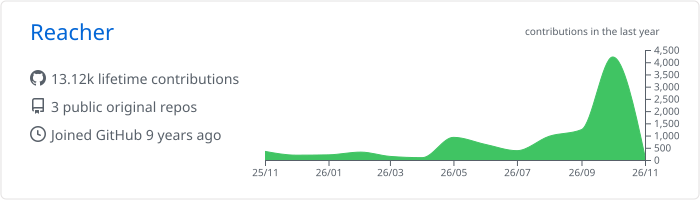
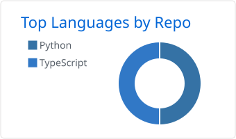
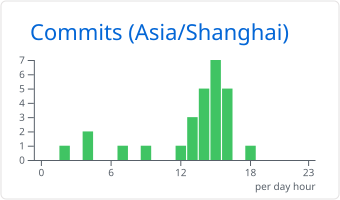
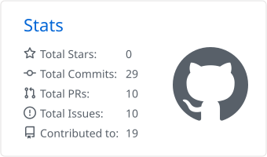
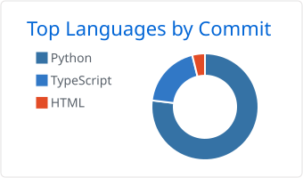

# Reacher

I build apps people crave, and contribute fixes back upstream.

## Open-source contributions

**3 pull requests merged across 3 projects** · 4 open

[Merged PRs](https://github.com/pulls?q=is%3Apr%20author%3Aprimerch%20is%3Apublic%20-user%3Aprimerch%20is%3Amerged%20sort%3Aupdated-desc) · [Open PRs](https://github.com/pulls?q=is%3Apr%20author%3Aprimerch%20is%3Apublic%20-user%3Aprimerch%20is%3Aopen%20sort%3Aupdated-desc) · [Full history](https://github.com/primerch/primerch/blob/main/HISTORY.md)

### Merged contributions

| Project / PR | Contribution | Merged |
| --- | --- | --- |
| [rag #120](https://github.com/convex/rag/pull/120) | Fix a type-only import for build compatibility | 2026-11-04 |
| [ooxml #241](https://github.com/ChristopherVR/ooxml/pull/241) | Preserve fills and strokes after PPTX animations | 2026-11-03 |
| [pptx-viewer #185](https://github.com/ChristopherVR/pptx-viewer/pull/185) | Restore authored PowerPoint playback and rendering | 2026-08-30 |

Merged code changes: **+4,907 / −491 lines**

## What I build

| Project | Focus |
| --- | --- |
| **SupaSchool** | A teaching and learning platform |
| **Imminfo** | An immigration information website |
| **Blink Approval** | A homework review interface |

These projects have private source repositories. Also on GitHub: [GESP Exam Assessment](https://github.com/primerch/gesp-exam-assessment) · [Purrge Website](https://github.com/primerch/purrge-website).

## Contribution analytics

<picture>
  <source media="(prefers-color-scheme: dark)" srcset="https://raw.githubusercontent.com/primerch/primerch/main/assets/github_dark/0-profile-details.svg">
  <source media="(prefers-color-scheme: light)" srcset="https://raw.githubusercontent.com/primerch/primerch/main/assets/github/0-profile-details.svg">
  
</picture>

The headline shows lifetime contributions; the trend shows the past year. Public original repositories exclude forks. [Open full-size activity chart](https://raw.githubusercontent.com/primerch/primerch/main/assets/github/0-profile-details.svg).

<picture>
  <source media="(prefers-color-scheme: dark)" srcset="https://raw.githubusercontent.com/primerch/primerch/main/assets/github_dark/1-repos-per-language.svg">
  <source media="(prefers-color-scheme: light)" srcset="https://raw.githubusercontent.com/primerch/primerch/main/assets/github/1-repos-per-language.svg">
  
</picture>
<picture>
  <source media="(prefers-color-scheme: dark)" srcset="https://raw.githubusercontent.com/primerch/primerch/main/assets/github_dark/4-productive-time.svg">
  <source media="(prefers-color-scheme: light)" srcset="https://raw.githubusercontent.com/primerch/primerch/main/assets/github/4-productive-time.svg">
  
</picture>

Language and hourly charts cover public code only.

More charts and what these numbers mean

<picture>
  <source media="(prefers-color-scheme: dark)" srcset="https://raw.githubusercontent.com/primerch/primerch/main/assets/github_dark/3-stats.svg">
  <source media="(prefers-color-scheme: light)" srcset="https://raw.githubusercontent.com/primerch/primerch/main/assets/github/3-stats.svg">
  
</picture>
<picture>
  <source media="(prefers-color-scheme: dark)" srcset="https://raw.githubusercontent.com/primerch/primerch/main/assets/github_dark/2-most-commit-language.svg">
  <source media="(prefers-color-scheme: light)" srcset="https://raw.githubusercontent.com/primerch/primerch/main/assets/github/2-most-commit-language.svg">
  
</picture>

- **Contributions** count qualifying GitHub activity, including commits, issues, PRs, reviews, and repository creation. The trend covers the past year and includes the anonymized private activity shared on my profile. It does not count lines of code.
- **Merged PRs** show changes accepted by upstream projects. This homepage counts public external PRs separately from work in my own repositories.
- **Language charts** describe public repository code or commit activity, not proficiency. Private code is outside this integration's access, and this profile automation repository is excluded.
- **Activity by hour** shows when public commits were made in Asia/Shanghai. It does not measure hours worked.
- **Projects** above are a portfolio. GitHub's separate Projects tab contains planning boards.

Charts are generated by [GitHub Profile Summary Cards](https://github.com/vn7n24fzkq/github-profile-summary-cards) and stored in this repository. If the chart service is unavailable, the last saved charts stay visible and PR history continues to refresh independently. [How GitHub counts contributions](https://docs.github.com/en/account-and-profile/reference/profile-contributions-reference).

### Open pull requests

| Project / PR | Contribution |
| --- | --- |
| [better-auth #460](https://github.com/convex/better-auth/pull/460) | Keep token refresh pending during temporary outages |
| [opentype.js #883](https://github.com/opentypejs/opentype.js/pull/883) | Route ES module consumers to the ESM build |
| [convex-backend #631](https://github.com/convex/convex-backend/pull/631) | Fix auth configuration races during token retrieval |
| [monaco-vim #176](https://github.com/brijeshb42/monaco-vim/pull/176) | Handle Vim keys before native editor shortcuts |

All-time totals and closed PRs

10 PRs submitted to 8 public upstream repositories: 3 merged, 4 open, 3 closed without merging.

| Project / PR | Contribution |
| --- | --- |
| [opentype.js #882](https://github.com/opentypejs/opentype.js/pull/882) | fix: route ES module consumers to the ESM build |
| [pptx-viewer #184](https://github.com/ChristopherVR/pptx-viewer/pull/184) | fix(animation): preserve authored PowerPoint playback and rendering |
| [intro-to-github #4126](https://github.com/hyperskill/intro-to-github/pull/4126) | Update README.md |

Only public upstream repositories are counted. My own repositories and private work are excluded. Line counts sum merged PR diffs, including tests; they are not a count of unique lines. Closed PRs are not counted as merged.

Latest PR activity: 2026-11-04 11:26 UTC+8 · [Sync log](https://github.com/primerch/primerch/actions/workflows/update-profile.yml) · Refreshed hourly; GitHub scheduling may be delayed
