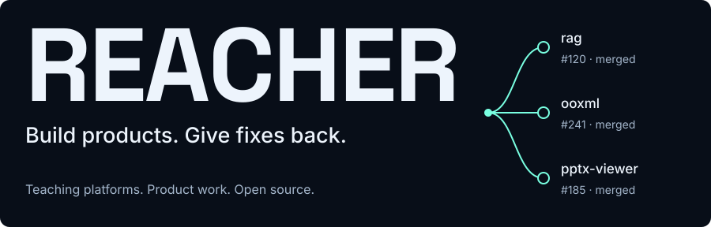
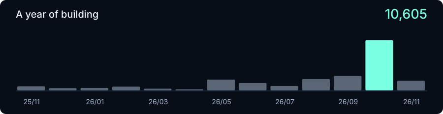

<picture>
  <source media="(max-width: 600px)" srcset="https://raw.githubusercontent.com/primerch/primerch/main/assets/brand/hero-dark-mobile.svg?v=5a22e96602fe">
  
</picture>

**13,129 lifetime contributions.** Public work and anonymous private activity, counted together.

[Merged upstream (3)](https://github.com/pulls?q=is%3Apr%20author%3Aprimerch%20is%3Apublic%20-user%3Aprimerch%20is%3Amerged%20sort%3Aupdated-desc) · [Open PRs (4)](https://github.com/pulls?q=is%3Apr%20author%3Aprimerch%20is%3Apublic%20-user%3Aprimerch%20is%3Aopen%20sort%3Aupdated-desc) · [Full contribution history](https://github.com/primerch/primerch/blob/main/HISTORY.md)

## Built by me

<picture>
  <source media="(max-width: 600px)" srcset="https://raw.githubusercontent.com/primerch/primerch/main/assets/brand/products-dark-mobile.svg?v=35b30f45315f">
  
</picture>

Source stays private. Also on GitHub: [GESP Exam Assessment](https://github.com/primerch/gesp-exam-assessment) · [Purrge Website](https://github.com/primerch/purrge-website).

## GitHub, in numbers

<picture>
  <source media="(prefers-color-scheme: dark)" srcset="https://raw.githubusercontent.com/primerch/primerch/main/assets/extended/stats-dark.svg?v=bef74d832e62">
  <source media="(prefers-color-scheme: light)" srcset="https://raw.githubusercontent.com/primerch/primerch/main/assets/extended/stats-light.svg?v=25cab7c05032">
  
</picture>
<picture>
  <source media="(prefers-color-scheme: dark)" srcset="https://raw.githubusercontent.com/primerch/primerch/main/assets/extended/languages-dark.svg?v=db1062dc404e">
  <source media="(prefers-color-scheme: light)" srcset="https://raw.githubusercontent.com/primerch/primerch/main/assets/extended/languages-light.svg?v=cb03b0855562">
  
</picture>

Lifetime contributions include anonymous private activity. The language chart covers public source code.

<picture>
  <source media="(max-width: 600px)" srcset="https://raw.githubusercontent.com/primerch/primerch/main/assets/brand/activity-dark-mobile.svg?v=4050cd55bc0c">
  
</picture>

**9,859 contributions in the past year**, including **9,795 anonymous private contributions**. Private repository names, commits, and source code stay private.

## Accepted upstream

**3 pull requests merged across 3 projects** · 4 open

| Project / PR | Contribution | Merged |
| --- | --- | --- |
| [rag #120](https://github.com/convex/rag/pull/120) | Fix a type-only import for build compatibility | 2026-11-04 |
| [ooxml #241](https://github.com/ChristopherVR/ooxml/pull/241) | Preserve fills and strokes after PPTX animations | 2026-11-03 |
| [pptx-viewer #185](https://github.com/ChristopherVR/pptx-viewer/pull/185) | Restore authored PowerPoint playback and rendering | 2026-08-30 |

Merged code changes: **+4,907 / −491 lines**

4 open upstream pull requests

| Project / PR | Contribution |
| --- | --- |
| [better-auth #460](https://github.com/convex/better-auth/pull/460) | Keep token refresh pending during temporary outages |
| [opentype.js #883](https://github.com/opentypejs/opentype.js/pull/883) | Route ES module consumers to the ESM build |
| [convex-backend #631](https://github.com/convex/convex-backend/pull/631) | Fix auth configuration races during token retrieval |
| [monaco-vim #176](https://github.com/brijeshb42/monaco-vim/pull/176) | Handle Vim keys before native editor shortcuts |

How the numbers work

- **Lifetime contributions** count qualifying GitHub activity across all contribution years, including the anonymized private activity shared on my profile.
- **Past-year activity** covers GitHub's trailing-year contribution calendar. Boundary months in the monthly chart are partial.
- **Anonymous private contributions** are aggregate activity counts. No private repository names, commit messages, paths, or code are published.
- **Public PRs** and **Public merged PRs** on the Stats Extended card cover public repositories. The upstream section below the charts specifically excludes my own repositories.
- **Public language mix** counts public code bytes, excluding forks and this profile automation repository. It does not measure proficiency or expose private code.
- **Merged code changes** sum accepted upstream PR diffs, including tests. They are not a deduplicated count of authored lines.

Statistics are generated by [GitHub Stats Extended](https://github.com/stats-organization/github-stats-extended) with its [official Action](https://github.com/stats-organization/github-readme-stats-action). Saved charts stay visible between updates. [GitHub's contribution rules](https://docs.github.com/en/account-and-profile/reference/profile-contributions-reference).

Full public upstream totals and closed PRs

10 PRs submitted to 8 public upstream repositories: 3 merged, 4 open, 3 closed without merging.

| Project / PR | Contribution |
| --- | --- |
| [opentype.js #882](https://github.com/opentypejs/opentype.js/pull/882) | fix: route ES module consumers to the ESM build |
| [pptx-viewer #184](https://github.com/ChristopherVR/pptx-viewer/pull/184) | fix(animation): preserve authored PowerPoint playback and rendering |
| [intro-to-github #4126](https://github.com/hyperskill/intro-to-github/pull/4126) | Update README.md |

These PR totals count public upstream repositories. My own repositories and private PRs are excluded here; anonymous private activity is included in the contribution totals above. Closed PRs are not counted as merged.

Data refreshed 2026-11-04 · Latest PR activity: 2026-11-04 12:32 UTC+8 · [Hourly sync](https://github.com/primerch/primerch/actions/workflows/update-profile.yml)
